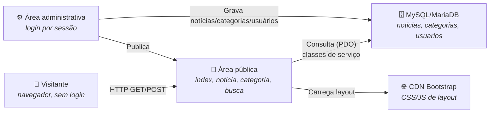
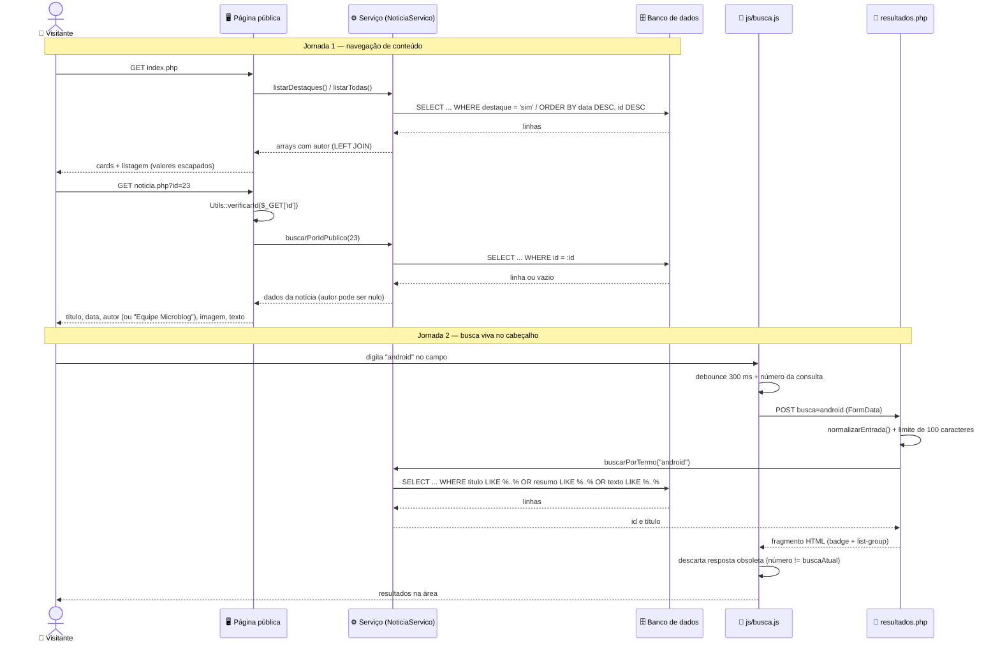
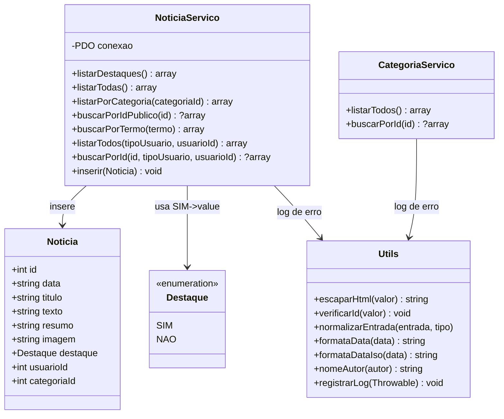

# Fluxo — Área pública do Microblog + busca

> Documento vivo do estado atual após a entrega da área pública dinâmica e do
> sistema de busca. Atualizar quando houver mudança de arquitetura, novo endpoint
> ou alteração no fluxo principal.

## 1. Visão Geral de Contexto

> Como a área pública se insere no ecossistema do projeto.

## 2. Fluxo da Solução

> Caminho percorrido pelo dado nas duas jornadas implementadas: navegação de
> conteúdo e busca viva.

## 3. Especificação Técnica

> Componentes envolvidos e os contratos usados pelas páginas públicas.

### Tabela de Handoff (Contratos das páginas públicas)

| Rota / Endpoint | Método | Entrada | Saída | Arquivo |
|---|---|---|---|---|
| `index.php` | GET | — | HTML com 1 card por notícia em destaque (imagem, título, resumo, link) + listagem "Todas as notícias" | `index.php` + `includes/todas.php` |
| `noticia.php` | GET | `id` (int ≥ 1) na query string | HTML do detalhe; `id` inválido → 302 `index.php`; id inexistente → `alert('Notícia não encontrada.')` | `noticia.php` |
| `noticias-por-categoria.php` | GET | `id` (int ≥ 1) da categoria | HTML com badge do nome da categoria e itens (título, data, autor, resumo); vazio → "Não há notícias desta categoria" | `noticias-por-categoria.php` |
| `resultados.php` | POST | `busca` (texto, até 100 caracteres após normalização) | Fragmento HTML: `<h2>Resultados: badge N</h2>` + `list-group`, ou `<h2 class="fs-5 text-danger">Sem notícias</h2>`, ou alerta de erro | `resultados.php` |
| `includes/cabecalho.php` | — (include) | — | Menu de categorias do banco (`noticias-por-categoria.php?id=N`) | `includes/cabecalho.php` |
| `js/busca.js` | — (cliente) | evento `input` no `#campo-busca` | `fetch POST` em `resultados.php`; injeta o fragmento em `#resultados`; erro de rede/HTTP → `p.alert.alert-warning` | `js/busca.js` |
